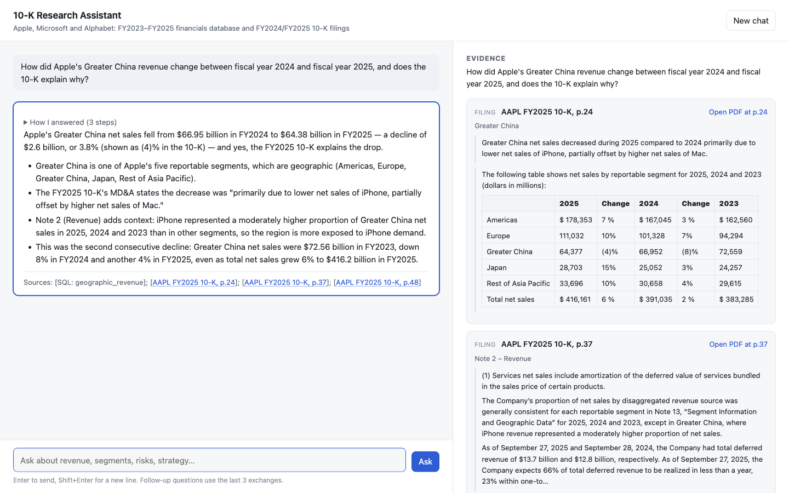

# 10-K research assistant: agentic RAG on Fireworks

A local assistant that answers questions about Apple, Microsoft and Alphabet from a SQLite database of annual
financials and their FY2024/FY2025 10-K filings. A tool-calling agent (glm-5p3 on Fireworks) decides whether a
question needs the database, the filings or both, gathers evidence over several steps, and answers with citations
you can check against the source.

- **Report:** [REPORT.md](REPORT.md) (design, retrieval, evaluation, trade-offs)
- **Dev-set answers:** [dev_answers.json](dev_answers.json)
- **Assignment brief:** [docs/ASSIGNMENT.md](docs/ASSIGNMENT.md)



## Run it

Requirements: macOS or Linux, [uv](https://github.com/astral-sh/uv), and a Fireworks API key with access to
serverless models.

```bash
./setup.sh                          # virtual env + dependencies; reuses the data and search index in data/
# add your key to .env (setup.sh creates it from .env.example):  FIREWORKS_API_KEY=...
.venv/bin/python -m app.server      # http://localhost:8000
```

Open <http://localhost:8000> and ask a question, or click an example. The database, PDFs and a prebuilt search index
ship in `data/`, so nothing is downloaded or re-embedded.

### Environment variables (`.env`)
| Variable | Required | Default | Purpose |
|---|---|---|---|
| `FIREWORKS_API_KEY` | yes | | Fireworks API key |
| `CHAT_MODEL` | no | `accounts/fireworks/models/glm-5p3` | Answer model (if your account lacks it, `glm-5p3-flash` scored 31/32 in our comparison) |
| `AGENT_TIME_BUDGET_S` | no | `90` | Per-question time budget; past it the API returns 504 |
| `PLANNER` | no | `off` | `on` plans every question before researching; the UI toggle does this per question |
| `PORT` / `HOST` | no | `8000` / `127.0.0.1` | Server address |
| `JUDGE_MODEL` | no | `accounts/fireworks/models/deepseek-v4p1-flash` | Evaluation judge only |

## API

`POST http://localhost:8000/api/chat` with `{"question": "...", "history": [...]?, "plan": true?}`.

```bash
# JSON (default)
curl -s -X POST localhost:8000/api/chat -H 'Content-Type: application/json' \
  -d '{"question": "What was Microsoft'"'"'s total revenue in fiscal year 2025?"}'
# -> {"answer": "...", "content": "...", "sources": [...], "steps": [...], "usage": {...}}

# Server-sent events
curl -sN -X POST localhost:8000/api/chat -H 'Content-Type: application/json' -H 'Accept: text/event-stream' \
  -d '{"question": "How did Apple'"'"'s Greater China revenue change in fiscal year 2025, and why?"}'
# -> event: step (one per tool call) ... event: answer {"content": "..."}, event: sources, event: done
```

- `answer` and `content` hold the same text; `sources` lists only the evidence the answer cites (filing passages
  with page links, SQL queries with their rows); `steps` lists each action the agent took.
- `history` (optional): earlier `{"role", "content"}` turns for follow-up questions (last 6 messages are used).
- `plan` (optional): `true` writes and shows a plan before researching; omitted uses the server default (off).
- Status codes: 422 bad request, 502 the model provider failed, 504 over the time budget, 500 internal error. A
  stream that has already started reports failures as an `error` event.
- Interactive API docs: <http://localhost:8000/docs>. Health check: `GET /api/health`.

## Using the web page
- Steps appear live while the agent works; "How I answered" keeps them under the answer.
- The **evidence panel** shows what the selected answer cites: each filing page with the passages the agent read
  and an "Open PDF at p.N" link, and each database citation with its SQL and rows. Click an answer to show its
  evidence; citations in the text highlight their card.
- Long answers show the direct answer first, with supporting points under "Details".
- Follow-up questions use the last three exchanges; "New chat" clears them. "Plan first" shows a plan before the
  research.

## Repository map
| Path | What it is |
|---|---|
| `app/agent.py` | The agent loop: tools, routing checks, budgets |
| `app/tools.py`, `app/retrieval.py` | SQL tool, filing search (BM25 + embeddings + reranker), section reader, calculator |
| `app/prompts.py` | System prompt; the shipped answer format is `v1r` (others are tested alternatives) |
| `app/server.py`, `app/static/index.html`, `app/evidence.py` | API, web page, cited-evidence view |
| `app/ingest.py` | Builds the search index from the PDFs (`python -m app.ingest`; needs the API key to embed) |
| `app/planner.py`, `app/editor.py`, `app/baseline.py` | Optional planner (UI toggle); answer editor and non-agent baselines (experiments, off) |
| `eval/` | Evaluation harness, graders, questions, gold facts and analysis tools |
| `tests/` | Unit tests (no API calls): `python -m unittest discover tests` |
| `results/` | Every evaluation run behind the report; see [results/README.md](results/README.md) |
| `plans/` | Decision records, including the pre-registered final evaluation ([plans/final_eval.md](plans/final_eval.md)) |
| `docs/` | Assignment brief, conciseness experiments, screenshots |

## Reproducing the evaluation
All commands from the project root with the virtual environment's Python. Costs are approximate, at Fireworks
serverless prices.

```bash
.venv/bin/python -m unittest discover tests                          # free: 41 tests, fake model, no API key needed
.venv/bin/python -m eval.run_eval --set dev                          # 10 dev questions (~$0.25 incl. judging)
.venv/bin/python -m eval.run_eval --set tune --max-usd 1.2           # 47 tuning questions (~$1.20)
.venv/bin/python -m eval.run_eval --set holdout --final --runs 3     # 13 holdout questions x 3 (~$0.60)
.venv/bin/python -m eval.robustness --runs <run_id> --holistic --second-judge kimi-k3
.venv/bin/python -m eval.failures --runs <run_id>                    # failure table with suggested causes
.venv/bin/python -m eval.export_dev_answers --run <run_id>           # writes dev_answers.json
```

Each run writes `results/<run_id>/` with `answers.jsonl`, `scores.jsonl`, a `scorecard.md` and, via
`python -m eval.answers_report --run <run_id>`, a readable `answers.md`. Answers vary slightly between runs (the
model is sampled at temperature 0, but Fireworks does not guarantee identical outputs).

`dev_answers.json` comes from run `20261106-2313_tune_glm-5p3_v1r_gn_ed_final_cand_noedit` (run 0), produced by the
shipped configuration.
